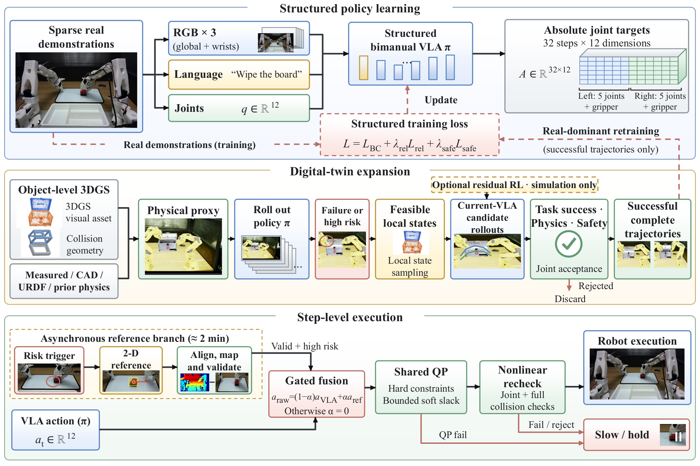

# More from Less

**3D Gaussian Splatting Digital Twins with Iterative Expansion and Trajectory Compensation for Sparse-Demonstration Bimanual Manipulation**

[Project website](https://robovla.github.io/More-from-Less/) · [GitHub repository](https://github.com/RoboVLA/More-from-Less) · [Source browser](https://robovla.github.io/More-from-Less/code.html) · [Reproducibility](docs/REPRODUCIBILITY.md) · [Method reference](docs/METHOD_REFERENCE.md)

MFL learns coordinated bimanual actions from sparse real demonstrations. In simulation, the current policy’s failures guide where to collect new training trajectories. During recovery stages that can tolerate a delay, the controller can request a video and use its tracked motion to correct a high-risk step.

[](static/media/v221/figure-1.pdf)

## Method

1. **Learn the joint action.** Three synchronized RGB views, language and joint state feed a shared VLA policy. Each of its 32 steps contains five joint targets and one gripper target per arm. The training loss compares predicted and demonstrated actions in a common geometry: the relative translation and rotation of the two end effectors and the minimum clearance of prohibited robot link pairs. Contact and role labels are fixed training context. [Policy diagram](static/media/v221/figure-2.pdf)
2. **Expand around failures.** The background and movable objects have independent 3DGS appearance models. Separate collision geometry and externally assigned physics allow the policy to interact with them in Isaac Sim. A failed or high-risk state identifies a neighborhood for sampling feasible starts. Only complete successful trajectories passing task, physics and safety checks enter the cumulative virtual set. Retraining gives real demonstrations greater weight, and the updated policy identifies the next neighborhoods. Optional residual RL proposes candidates in simulation. [Expansion diagram](static/media/v221/figure-3.pdf)
3. **Recover individual steps.** During delay-tolerant recovery, a risk-threshold crossing, stage transition or local failure can trigger an asynchronous request to Kling AI 3.0 (about two minutes). The base policy keeps running through the safety filter. When the video returns, the controller tracks the target in 2D and aligns it to the current state and task stage. Depth from the head camera, calibration and task-masked inverse kinematics supply local joint targets. The grippers retain the VLA commands. A valid reference contributes only at high risk. Both base and fused commands pass through the same QP and nonlinear recheck before execution. [Execution diagram](static/media/v221/figure-4.pdf)

## Results

| Manuscript comparison | Evaluation unit and metric | Reported means |
|---|---|---|
| Table 1 · Naive VLA → Structured VLA → Full Pipeline | Success across four functional stages, equally weighted within each paired unit | 68.83% → 75.83% → 89.00% |
| Table 2 · Uniform rollout → Failure-region expansion | Complete real-robot task success, with successful trajectories selected in both configurations | 78.83% → 84.33% |
| Table 4 · Video-reference baseline → Full compensation | Step recovery on matched trigger segments | 53.33% → 67.78% |
| Table 6 · Full Pipeline → Step compensation disabled | Step recovery in the separate ablation task pool | 69.56% → 31.78% |

We designed six tabletop tasks for the SO101 bimanual platform. They include pouring, opening a microwave, opening a medicine box, board wiping, sequential wiping–pouring, and cooperative wiping with one arm holding the board steady. Table 1 uses 15 paired policy–environment units: five independently trained policies, each evaluated with three environment seeds. The [project results](https://robovla.github.io/More-from-Less/#results) give the full four tables with sample standard deviations.

## What the release reproduces

The appendix command below recomputes the saved offline fusion outputs. In Appendix Fig. A.4, fusion reduces mean distance to the retargeted input by 61.2% for pouring and 62.0% for wiping. The retargeted trajectory is itself an input to fusion. These figures describe offline processing. Online recovery is evaluated separately in Table 4.

The training, expansion and control code provides reference implementations with analytic fixtures. Reproducing the original robot evaluations would also require the historical checkpoints, complete demonstrations and episode logs, which are unavailable.

## Quick start

Python 3.10 or newer. Clone the repository before running the examples:

```bash
git clone https://github.com/RoboVLA/More-from-Less.git
cd More-from-Less
python -m venv .venv
```

Activate the environment with `.venv\Scripts\Activate.ps1` in Windows PowerShell or `source .venv/bin/activate` on Linux/macOS, then run:

```bash
python -m pip install -r requirements.txt
python -m unittest discover -s tests -v
python -m morefromless.trajectory.reproduce_appendix
python paper_pipeline/run_morefromless_pipeline.py --dry-run --include-disabled
```

The appendix command reconstructs the time-varying fusion, smoothing, and pouring depth treatment from the retained G/R input CSVs. It checks every pose component against the saved F CSVs (72 pouring points and 75 wiping points) and writes results to `outputs/appendix_reproduction/`. Input data are not overwritten. `python paper_pipeline/run_morefromless_pipeline.py` runs this same procedure.

For PyTorch gradient and training-interface checks:

```bash
python -m pip install -r requirements-method.txt
python -m unittest discover -s tests -v
```

Without PyTorch, gradient tests are explicitly skipped. Optional pipeline stages `structured_vla`, `failure_expansion`, and `online_compensation` run engineering checks, not the reported robot experiments. See the [adapter requirements](docs/METHOD_REFERENCE.md) for new training and system integration. An editable install is optional: `python -m pip install -e .`.

## Repository guide

| Location | Contents and scope |
|---|---|
| [Method reference](morefromless/method/) | Differentiable relation supervision/FK, training interface, expansion/acceptance engine, asynchronous references, DLS and shared filtering. Actual model, geometry, simulation and device adapters are required. |
| [Trajectory tools](morefromless/trajectory/) | Pose I/O, generic fusion and exact appendix recomputation; offline diagnostics only. |
| [Trajectory examples](examples/trajectories/) | Retained generated, retargeted and fused trajectories; no new real-robot data. |
| [Reconstruction/proxy snapshots](reference_code/) | Object reconstruction, collision assets, USD/hinge assembly and simulator integration. Upstream environments must be configured separately. |
| [Camera utilities](tools/gemini_camera/) | RGB-D acquisition and tuning; hardware, drivers and SDK required. |
| [Historical video tools](tools/trajectory_compensation/) | Original offline processing scripts with scene-specific defaults. |
| [Pipeline entry](paper_pipeline/) | Appendix reproduction and optional reference-module checks. |
| [Manuscript figures](static/media/v221/) | Figures 1–8 and A.1–A.4 from English manuscript v221, with individual PDFs and web previews. |
| [Validation record](docs/VALIDATION.md) | Verified scope, preserved data and known limits. |

The [paper-to-code map](docs/PAPER_PIPELINE.md), [source manifest](docs/source_manifest.json), and [asset guide](docs/DATA_AND_ASSETS.md) record provenance and version boundaries.

## Generic fusion example

This fixed-weight example is separate from appendix reproduction:

```bash
python -m morefromless.trajectory.fuse_trajectories --generated examples/trajectories/pour/generated_pose_xyzrpy.csv --real-retargeted examples/trajectories/pour/real_retargeted_pose_xyzrpy.csv --out-dir outputs/pour_demo --real-weight 0.55
```

Input columns are `frame,time_s,x,y,z,rx,ry,rz`. Examples use millimeters, degrees, and camera coordinates (+X right, +Y down, +Z forward). Both inputs must share time origin, frame and units. Component-wise interpolation/fusion holds endpoints outside the reference interval; it is not SE(3) interpolation or a 12-D robot joint command. The example weight is not the online gate weight.

## Website and local preview

The public website is **https://robovla.github.io/More-from-Less/**. GitHub Pages publishes the root of `main`. To preview a clone locally:

```bash
python scripts/serve.py --port 18765
```

Open the loopback address printed by the server. It is a local preview, not the public project address. If the port is occupied, choose another with `--port`; do not stop another project's service. The source browser requires HTTP. See [release and hosting notes](docs/LOCAL_RELEASE.md).

## Dependencies, citation and licensing

NumPy supports the lightweight trajectory, expansion and control references. PyTorch is required for differentiable supervision/FK and training. Optional video and geometry dependencies are in [requirements-vision.txt](requirements-vision.txt) and [requirements-geometry.txt](requirements-geometry.txt). Camera, GPU and Isaac Sim snapshots require their upstream environments.

Use [CITATION.cff](CITATION.cff) for this software release. No journal acceptance or DOI is claimed. Project-authored code is MIT licensed; third-party snapshots retain their own terms. Manuscripts, figures, videos and example data are not automatically covered by the code license. See [LICENSE](LICENSE) and [third-party notices](THIRD_PARTY_NOTICES.md).
